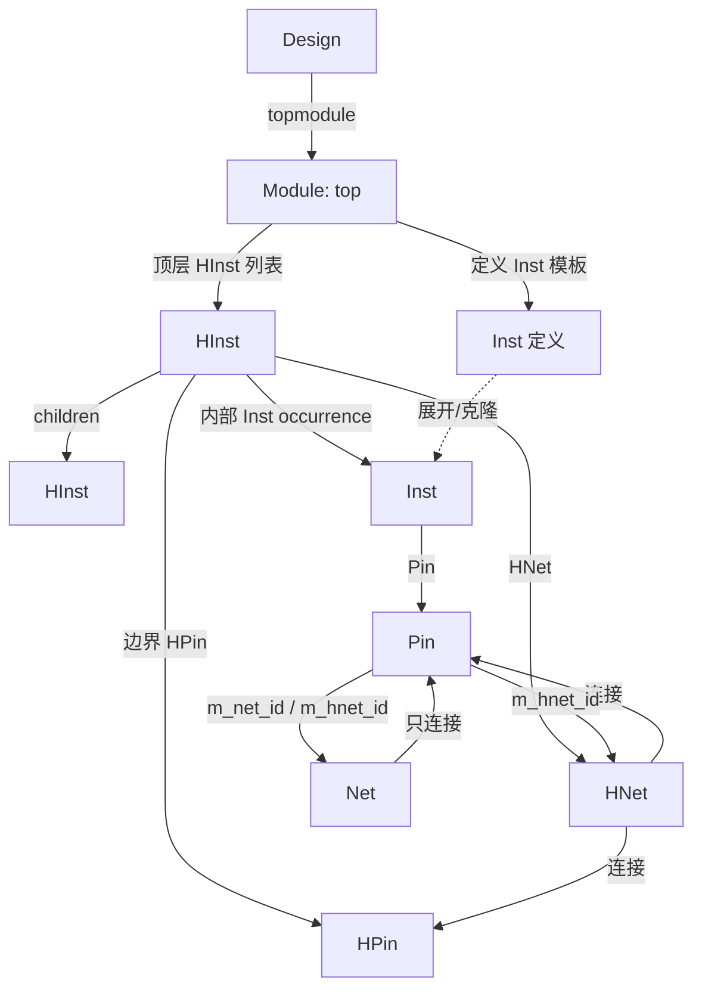

# Database 设计文档

> 状态：目标模型基线（Design-centric）
>
> 范围：C++20 EDA 网表数据库的逻辑对象、层次展开、连接、导航与持久化边界。本文是讨论结论的汇总；类级文档见 [doc/README.md](doc/README.md)，具体需求/接口细节以 `docs/pdr/01-architecture/` 和 ADR 为准。

## 1. 目标

Database 提供一个以 **Design** 为中心的逻辑/层次数据库，用于承载展开、优化、约束和后续物理流程所需的网表对象。

核心目标：

- 一个 **Design** 是一份完整用户设计，也是持久化单元；
- 层次由 **HInst** 树表达，Module 只作为定义；
- 逻辑连接由 **Net/Pin** 表达，层次内连接由 **HNet/HPin** 表达；
- 对象通过缓存的 `GetDesign` / `GetModule` / `GetHInst` 直接导航，不沿父链循环；
- 逻辑模型与后续物理视图分离：物理/寄生数据在 **Net**，HNet 只做层次代理。

非目标（当前阶段）：

- 不提供 Design 的实例化/嵌套；不存在“Design 里的 Design”；
- 不把 Module 当作层次节点；
- 不把物理/寄生字段放到 HNet；
- 不在本文规定具体磁盘文件格式（持久化语义见 NFR/ADR）。

## 2. 对象总览

简化关系：

| 对象 | 角色 | 关键归属 |
| :--- | :--- | :--- |
| `Design` | 完整设计、持久化根 | topmodule、名称池、SDC、库引用、物理视图 |
| `Module` | 逻辑定义/容器 | ports、Inst 定义；topmodule 额外持有顶层 HInst 列表 |
| `HInst` | Module 实例化的层次出现 | child HInst、内部 Inst/HNet、边界 HPin、上下层链接 |
| `Inst` | Module 内部的叶实例 | 目标 LibCell；不可展开 |
| `Net` | 顶层唯一逻辑网络 | 只连接 Pin；承载物理/寄生数据 |
| `Pin` | Inst/Module port 的连接点 | 同时保存 `m_net_id` 与 `m_hnet_id` |
| `HNet` | Net 在某个 HInst 层级的代理 | 连接该层所有 Pin 和 HPin；唯一对应一个 Net |
| `HPin` | 层次边界引脚 | 归 HInst；通过 HNet 连接 |
| `ModulePort` | Module 对外端口 | 通过 io Pin 接入 Net/HNet |

## 3. Design

**Design** 是一个完整用户设计的设计上下文，也是持久化单元。

Design 拥有：

- `top_module`：本 Design 的顶层 Module，也是层次根；
- Design 私有的 `StringMgr` / `IdArrayMgr` 与对象名称；
- 逻辑对象（Inst、Net、Pin、ModulePort 等）；
- SDC/MCMM 约束；
- TechLib/TimingLib 的只读引用；
- 展开/打平后的物理视图。

Design 不拥有/不维护：

- 不存在 Design 实例或 Design 嵌套；
- 不维护 helper Module 表，也不持有 HInst 链表；从 topmodule 沿 HInst 树遍历即可访问 helper/base/unique Modules；
- 不跨 Design 共享可变设计对象；只读 base Module/库可以共享。

`current_design` 是工具当前活动的 Design。多个 Design 可以并存，但工具通常只展开/优化当前 Design。

持久化语义：

- 保存/加载以 Design 为单位；
- 快照覆盖 topmodule、HInst 树、从 HInst 可达的 Modules、名称、约束、物理视图和库解析信息；
- 不要求存在独立的 helper Module 表；
- unique Module 通过 HInst 树可达并随快照保存。

## 4. Module

**Module** 是逻辑定义/容器，包含 Module ports 和 Inst 定义。Module 定义本身不持有 HInst tree；当它是 Design 的 topmodule 时，额外持有顶层 HInst 列表，作为层次入口并递归处理 HInst 树。

### 4.1 base 与 unique

- Module 默认是跨 Design 共享的**只读 base 定义**；
- 同一个 Module 可以是 Design A 的 topmodule，同时是 Design B 的 helper module；
- 基础 hierarchy expansion 不做 uniquify，HInst 默认引用共享 base Module；
- 需要设计私有修改时，HInst 对 Module 执行 **uniquify**，生成 unique 副本；
- **unique Module 保留原始 Module 的 Design 成员，不新建 Design**；
- unique Module 由原始 Design 管理，使用它的 helper Design 不建立 helper Module 表；
- HInst 记录它引用的是 base 还是 unique 副本。

### 4.2 Module 的边界

- Module 没有唯一 PathName；PathName 属于它在层次中的出现（HInst）；
- Module 不提供顶层导航；`HInst::m_module_id` 才是 topmodule 导航字段；
- Module 的 `GetDesign()` 返回其原始 Design；unique 副本不因被其他 Design 的 HInst 引用而改属；
- 名称/ID 作用域跟随原始 Design + Module 定义，base 与 unique 的身份需可区分。

## 5. HInst 层次

### 5.1 根

- `TopModule` 是 Design 的逻辑根，也是层次入口；
- Design 只持有 topmodule；顶层 HInst 列表由 topmodule 持有，Design 不维护 HInst 链表；
- Module 递归处理/遍历 HInst 树；**没有额外的 root HInst**；
- `HInst::m_module_id` 永远指向 topmodule；
- `HInst::m_template_id` 指向该 HInst 实例化的 Module 定义。

### 5.2 展开

hierarchy expansion 永远基于一个 Module：

1. 以该 Module 为 template；
2. 递归创建 HInst；
3. HInst 管理内部实例化的 child HInst、Inst、HNet；
4. 建立边界 HPin 和上下层链接；
5. 为展开对象写入 Design/topmodule/HInst 导航字段。

初始时 Design 只有 topmodule。topmodule 持有顶层 HInst 列表；HInst 持有 child HInst 列表。未展开的 HInst 内部链表为空；此时 Module 只能遍历其叶 Inst 定义。展开后从 topmodule 的顶层 HInst 或某个 HInst 自身开始递归向下遍历 child HInst。

### 5.3 HInst 持有内容

每个 HInst 可以持有：

- child HInst 链表；
- 内部 Inst 链表（该 occurrence 内的对象）；
- HNet 链表；
- 边界 HPin 链表；
- parent/sibling 链接。

HInst 是 occurrence 级容器；同一个 Module 可以被多个 HInst 出现，路径和 occurrence 数据互不混用。

### 5.4 PathName

- PathName 从 topmodule 名开始，沿 HInst 父链合成：`top/u0/u1`；
- 不把 flat path 作为主存储；
- Module 定义没有唯一 PathName；
- HInst 的 `GetHInst()` 返回上层 HInst，顶层 HInst 返回 null。

## 6. Inst

**Inst** 是 Module 内部的叶实例：

- 目标是 LibCell；
- 不可展开；
- 有局部名；
- Module 实例化永远产生 HInst，不会产生“可展开的 Inst”。

导航：

- `Inst::GetModule()` 返回 topmodule；
- `Inst::GetHInst()` 返回该 Inst 所在的 HInst；topmodule 直属 Inst 返回 null；
- `Inst::GetDesign()` 返回顶层 Design；
- 定义它的 Module 仅作为内部字段用于名称、PathName、Module 链表和销毁逻辑；不公开 owner 接口。

## 7. Net / Pin / HNet / HPin

### 7.1 Net

`Net` 是 Design/topmodule 级唯一的逻辑网络：

- 只连接 **Pin**；
- 不连接 HPin；
- 承载 physical/parasitic 数据；
- Net 不因多个 HNet 而复制；
- 可以有 0..N 个 HNet；未穿层级时可以为 0。

ModulePort 不直接接入 Net；通过其 io Pin 连接。

### 7.2 Pin

`Pin` 有两个独立的连接成员：

- `m_net_id`：全局 Net 连接；
- `m_hnet_id`：所在 HInst 层级的 HNet 连接。

因此同一个 Pin 可以同时属于一个 Net 和一个 HNet。这是层次内完整连接和顶层物理网络共存的关键。

### 7.3 HNet

`HNet` 是 Net 在某个 HInst 层级的代理：

- owner 为 **Module 或 HInst，二者互斥**；
- owner 为 Module：顶层 HNet；
- owner 为 HInst：展开产生的中间 HNet；
- 每个 HNet 唯一对应一个 Net；
- 每个 Net 每穿过一个 HInst，创建恰好一条 HNet；
- HNet 在所属 HInst 层级连接该层所有 Pin 和 HPin；
- HNet 只承载逻辑层次信息，不承载 physical/parasitic。

HNet 连接该层所有 Pin/HPin 的目的，是让本层次能够展示完整连接，而不是只展示跨边界连接。

### 7.4 HPin

`HPin` 是 HInst 的边界引脚：

- 归 HInst；
- 通过 HNet 接入；
- 不提供 `GetModule()`；
- `GetHInst()` 返回所属 HInst；
- `GetDesign()` 返回顶层 Design。

### 7.5 连接规则汇总

| 连接 | 是否允许 | 说明 |
| :--- | :--- | :--- |
| `Net` ↔ `Pin` | 是 | Net 只连接 Pin |
| `Net` ↔ `HPin` | 否 | 层次边界必须经 HNet |
| `Pin` ↔ `HNet` | 是 | Pin 同时保存 Net/HNet 连接 |
| `HNet` ↔ `Pin` | 是 | HNet 连接本层级所有 Pin |
| `HNet` ↔ `HPin` | 是 | HNet 连接本层级边界 HPin |
| `ModulePort` ↔ Net/HNet | 间接 | 通过其 io Pin |

## 8. 统一导航接口

所有逻辑对象在创建/层次展开时缓存导航字段，查询直接返回，不沿 parent 链循环。

| 对象 | `GetDesign()` | `GetModule()` | `GetHInst()` |
| :--- | :--- | :--- | :--- |
| `Module` | 原始/所属 Design | — | — |
| `HInst` | 顶层 Design | topmodule | 上层 HInst；顶层为 null |
| `Inst` | 顶层 Design | topmodule | 所在 HInst；topmodule 直属为 null |
| `Net` | 顶层 Design | topmodule | 所在 HInst；顶层 Net 为 null |
| `HNet` | 顶层 Design | topmodule | 所属 HInst；顶层 HNet 为 null |
| `HPin` | 顶层 Design | — | 所属 HInst |
| `ModulePort` | 所属 Module 的 Design | 所属 Module | — |

补充：

- `HInst::m_module_id` 直接给出 topmodule，`GetModule()` 不再循环；
- `HInst::GetHInst()` 返回上层 HInst，不是自身；
- `Inst`/`Net`/`HNet` 的 `GetHInst()` 返回所在 HInst；
- `GetDesign()`/`GetModule()`/`GetHInst()` 在创建/展开时赋值；禁止靠父链临时推导；
- 不保留 `GetMasterDesign` / `GetUpperHInst` / `HInst::GetTopModule` 等旧别名；
- `HInst::GetTemplateModule()` 保留，用于访问该 HInst 实例化的 Module 定义（与 `GetModule()` 的 topmodule 语义不同）。

## 9. 名称、ID 与持久化

### 9.1 PathName

- PathName 只属于 HInst 父链或 occurrence 视图；
- Module 本身没有唯一路径；
- PathName 按需合成，不存 flat path；
- 顶层 HInst 的路径以 topmodule 名为前缀。

### 9.2 名称与 ID

- Design 私有 StringMgr 提供名称 interning；
- 共享库对象使用库作用域名称，不与 Design 私有名称池混用；
- base/unique Module 的名称/身份需可区分；
- ObjectId 在所属对象表中稳定；持久化必须保持引用关系。

### 9.3 快照边界

- 快照以 Design 为根；
- 覆盖 topmodule、HInst 树、可达 Modules、名称、约束、物理视图；
- helper Module 不需要独立表；
- base 库通过版本/解析信息恢复；unique Module 通过 HInst 可达树保存；
- 不保证旧快照跨不兼容布局版本自动迁移，版本策略由 NFR 约束。

## 10. 库、SDC 与物理

### 10.1 库

- TechLib/TimingLib 是跨 Design 的只读 base；
- Design 默认持有引用，不复制整库；
- 需要设计私有修改时，通过 uniquify 创建 Design 私有副本；
- 共享 base 不可被 Design 直接修改；
- 库名称属于库作用域。

### 10.2 SDC/MCMM

- SDC/ConstraintSet 归 Design；
- MCMM 由 mode/corner/scenario 组合描述；
- TimingLib 提供共享 corner 数据；
- 约束引用 Design 对象或 PathName，生命周期随 Design。

### 10.3 物理

- 进入物理阶段前要求 expand/flatten topmodule；
- `Inst` 的 ref 在物理阶段扩展/绑定 LEF Macro；
- 物理布局、布线、寄生数据由 Design 的物理视图/Net 承载；
- `Net` 是物理信息的唯一载体；HNet 只表达逻辑层次；
- 不能把 physical/parasitic 字段写到 HNet。

## 11. 不变量

1. **Design 是完整设计与持久化根**；不存在 Design 实例/嵌套。
2. **只有 Module 可以被实例化，且实例化永远是 HInst**；Inst 是叶实例，不可展开。
3. Design 只管理 topmodule；topmodule 持有顶层 HInst 列表并递归处理 HInst 树；Design 不持有 HInst 链表。
4. TopModule 是 Design 的根；HInst 树从 topmodule 的顶层 HInst 向下展开；child HInst 由 HInst 持有。
5. `HInst::m_module_id` 永远是 topmodule；`m_template_id` 是该 HInst 实例化的 Module。
6. `GetModule()` 统一返回 topmodule；`GetHInst()` 对 HInst 返回上层，对 Inst/Net/HNet 返回所在 HInst；顶层 HInst/topmodule 直属对象为 null。
7. `GetDesign()` 对层次对象返回顶层 Design；Module 返回原始 Design，unique 保留原始 Design。
8. Net 只连接 Pin；Pin 同时保存 Net/HNet；HNet 连接本层级 Pin/HPin；HPin 只通过 HNet 接入。
9. Net 在 Design/topmodule 级唯一；每个 HNet 唯一对应一个 Net；每个穿过的 HInst 恰好一条 HNet。
10. PathName 只由 HInst 父链合成；Module 无唯一路径。
11. 物理/寄生数据在 Net；HNet 永远只承载逻辑层次信息。
12. base Module 可跨 Design 共享只读；unique Module 保留原始 Design、不新建 Design；Design 不维护 helper Module 表。

## 12. 当前实现状态

### 已实现

- Design 只持有 topmodule；topmodule 持有顶层 HInst 列表；
- HInst 树、parent/child/sibling、PathName；
- `HInst::m_module_id` / `m_template_id`；
- 统一导航字段和接口：`GetDesign` / `GetModule` / `GetHInst`；
- Module `GetDesign`、`Module::Clone` 保留原 Design；
- Pin 的 Net/HNet 双连接；
- HNet 连接 Pin 与 HPin 的容器/API；
- HInst 内部 Inst/HNet/HPin 容器字段与迭代器骨架；
- `ModuleHInstIterator` 遍历 topmodule 顶层 HInst，`HInstHInstIterator` 遍历 child HInst；
- 单测 41/41、ASan/UBSan 41/41、默认构建通过。

### 尚未实现/待后续

- 基于 Module 的递归 hierarchy expansion；
- 每个 HInst occurrence 的 Inst/HNet 克隆与自动填充；
- HInst 展开时自动把该层所有 Pin/HPin 挂到 HNet；
- `HInst::UniquifyModule` 的完整对象复制语义；
- Net/HNet 的完整创建与 owner 赋值 API；
- 物理视图、LEF Macro、寄生数据；
- base/unique Module 的版本和名称作用域细节。

> 说明：本文描述目标模型。当前代码中的 HInst 内部 Inst/HNet 链表仍为空，递归展开和自动连接逻辑尚未落地；不要把第 5/7 节的展开行为误认为当前已自动执行。

## 13. 参考文档

- [类级 logic 文档索引](doc/README.md)
- [DFG RTL/Logic 建模](doc/DFG.md)
- [PDR 01 架构总览](docs/pdr/01-architecture/00-README.md)
- [对象模型规范](docs/pdr/01-architecture/01-spec.md)
- [概念接口](docs/pdr/01-architecture/02-interfaces.md)
- [非功能约束](docs/pdr/01-architecture/03-nfr.md)
- [层次与 PathName](docs/pdr/01-architecture/design/hierarchy.md)
- [物理扩展](docs/pdr/01-architecture/design/physical.md)
- [术语表](CONTEXT.md)
- ADR：
  - [0002 Design 是完整设计与持久化根](docs/adr/0002-design-is-complete-persistence-root.md)
  - [0003 Module 是定义，Inst/HInst 是两类出现](docs/adr/0003-module-definition-and-hierarchy-occurrence.md)
  - [0005 物理数据在 Net 上](docs/adr/0005-physical-data-design-view.md)
  - [0006 Net/HNet 层次代理](docs/adr/0006-net-hnet-proxy-model.md)
  - [0007 Module base 共享与 uniquify](docs/adr/0007-module-base-sharing-uniquify.md)
  - [0008 层次展开与统一导航字段](docs/adr/0008-hierarchy-navigation-and-expansion.md)
