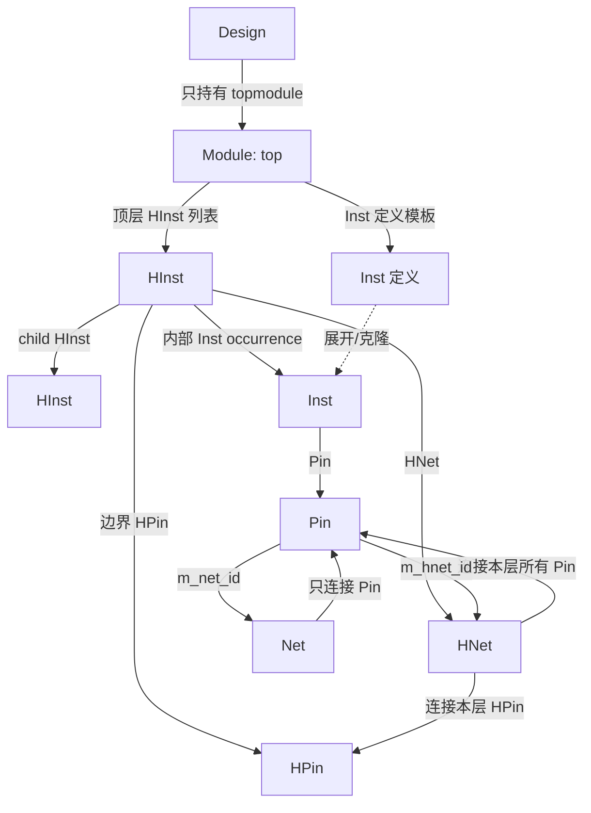

# Logic DB 设计理念

## 1. 核心判断

Logic DB 以 **Design** 为完整设计和持久化根，以 **Module → HInst → Inst** 区分“定义”和“出现”，以 **Net/Pin → HNet/HPin** 分离顶层物理网络与层次内连接。

一句话概括：

> **Design 管根，Module 管定义，HInst 管层次 occurrence，Inst 管叶实例；Net 管全局连接，Pin 同时保留 Net/HNet 两个连接，HNet 管本层次完整连接，HPin 管边界。**

## 2. 对象关系

关键点：

- Design **不持有 HInst 链表**；topmodule 持有顶层 HInst 列表；
- Module 是定义，HInst 是 occurrence；Module 不作为层次节点；
- Inst 是叶实例，不展开；
- Net 只连接 Pin；
- Pin 同时有 `m_net_id` 和 `m_hnet_id`；
- HNet 在所属 HInst 层级连接该层所有 Pin 和 HPin。

## 3. Design：边界与持久化

- Design 是完整用户设计，不是 Design 的实例；
- Design 只持有 `top_module`，不维护 helper Module 表，也不持有 HInst 链表；
- topmodule 持有顶层 HInst 列表，HInst 递归持有 child HInst；
- `current_design` 是当前活动 Design；
- 保存/加载以 Design 为单位；快照从 topmodule/HInst 树收集可达对象。

Design 不负责所有对象的物理存储细节，但它定义对象生命周期、名称池、约束和持久化边界。

## 4. 定义与出现

### Module

Module 是逻辑定义/容器，包含 ports 和 Inst 定义。

- Module 定义本身不持有 HInst tree；
- 当 Module 是 Design 的 topmodule 时，额外持有顶层 HInst 列表；
- 同一个 Module 可以是 A 的 top、B 的 helper；
- Module 默认以只读 base 共享，按需 uniquify；
- unique Module **保留原始 Design 成员，不新建 Design**；
- Module 没有唯一 PathName，也没有 topmodule 导航接口。

### HInst

HInst 是 Module 的层次 occurrence。

- `m_module_id` 永远指向 topmodule；
- `m_template_id` 指向实例化的 Module 定义；
- 管理 child HInst、内部 Inst、HNet、边界 HPin；
- 未展开时内部链表为空；
- `GetHInst()` 返回上层 HInst，顶层为 null；
- `GetModule()` 返回 topmodule；
- `GetTemplateModule()` 返回 template Module。

### Inst

Inst 是 Module 内部的叶实例，目标是 LibCell。

- 不可展开；
- `GetModule()` 返回 topmodule；
- `GetHInst()` 返回所在 HInst，topmodule 直属 Inst 为 null；
- 定义它的 Module 只作为内部字段，不公开 owner 接口。

## 5. 连接：Net 与 HNet 分工

### Net / Pin

- Net 是 Design/topmodule 级唯一逻辑网络；
- Net **只连接 Pin**，不连接 HPin；
- Net 承载 physical/parasitic 数据；
- Pin 有两个连接成员：
  - `m_net_id`：全局 Net；
  - `m_hnet_id`：当前 HInst 层级的 HNet。

Pin 同时属于 Net/HNet 是层次内完整连接和顶层物理网络共存的关键。

### HNet / HPin

- HNet 是 Net 在某 HInst 层级的代理；
- owner 为 Module（顶层 HNet）或 HInst（中间 HNet），二者互斥；
- 每个 HNet 唯一对应一个 Net；
- 每个 Net 每穿过一个 HInst，创建恰好一条 HNet；
- HNet 在所属 HInst 层级连接该层所有 Pin 和 HPin；
- HNet 只承载逻辑层次信息，不承载 physical/parasitic；
- HPin 是层次边界引脚，只通过 HNet 接入，不提供 `GetModule()`。

## 6. 导航：缓存字段，不做父链循环

所有导航字段在创建/展开时写入：

| 对象 | `GetDesign` | `GetModule` | `GetHInst` |
| :--- | :--- | :--- | :--- |
| `Module` | 原始 Design | — | — |
| `HInst` | 顶层 Design | topmodule | 上层 HInst；顶层 null |
| `Inst` | 顶层 Design | topmodule | 所在 HInst；直属 topmodule 为 null |
| `Net` | 顶层 Design | topmodule | 所在 HInst；顶层 null |
| `HNet` | 顶层 Design | topmodule | 所属 HInst；顶层 HNet null |
| `HPin` | 顶层 Design | — | 所属 HInst |

原则：

- `GetModule()` 统一返回 topmodule，不返回 owner/template Module；
- `GetHInst()` 统一返回层次归属：HInst 返回上层，其余返回所在 HInst；
- `GetDesign()` 对层次对象返回顶层 Design，Module 返回原始 Design；
- 不再保留 `GetMasterDesign`、`GetUpperHInst`、`HInst::GetTopModule` 等旧别名。

## 7. Base / unique

- Module 默认跨 Design 共享只读 base；
- 基础 hierarchy expansion 不 uniquify；
- 需要设计私有修改时，HInst 对 Module 执行 uniquify，生成 unique 副本；
- unique Module 不新建 Design，Design 成员仍是原始 Module 的 Design；
- HInst 记录它引用 base 还是 unique；
- 持久化通过 HInst 可达树收集 unique Module。

## 8. 物理边界

- 物理阶段要求 expand/flatten topmodule；
- Inst 的 ref 扩展/绑定 LEF Macro；
- Net 是物理/寄生数据的唯一载体；
- HNet 永远只是逻辑层次代理，不承载 physical/parasitic；
- 进入物理阶段前，HInst 层次必须可完整遍历。

## 9. 当前实现状态

已实现：

- Design 只持有 topmodule；topmodule 持有顶层 HInst 列表；
- ModuleHInstIterator + HInstHInstIterator 的层次遍历骨架；
- HInst/Inst/Net/HNet/HPin 导航字段；
- Pin 的 Net/HNet 双连接；
- HNet 的 Pin/HPin 连接容器与 API；
- 39/39 单测、ASan/UBSan、默认构建通过。

待后续：

- 基于 Module 的递归 hierarchy expansion；
- 每个 HInst occurrence 的 Inst/HNet 克隆与自动填充；
- HInst 展开时自动把该层所有 Pin/HPin 挂到 HNet；
- `HInst::UniquifyModule` 的完整对象复制；
- Net/HNet 创建与 owner 赋值 API；
- 物理视图/LEF/寄生。

> 本目录描述目标模型；未实现项在各类文档的“实现状态”中单独标注。
