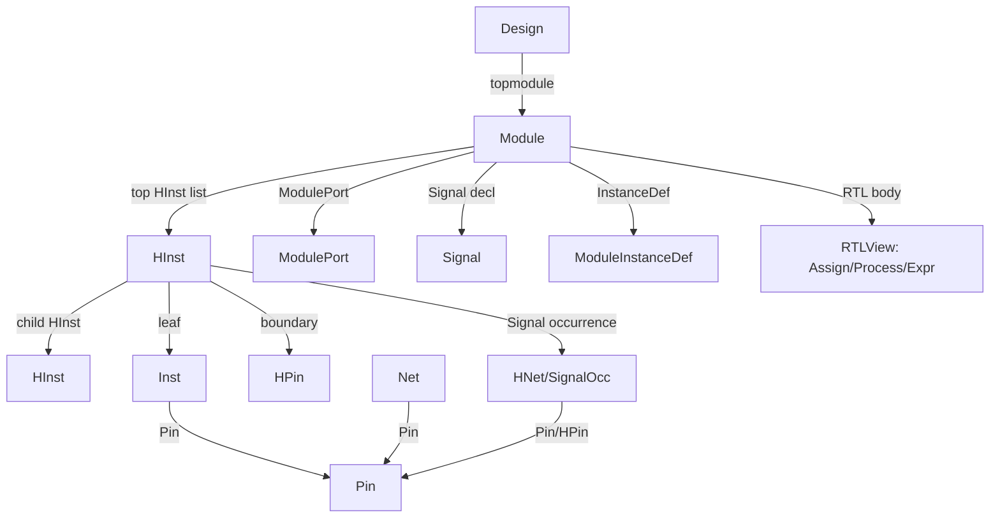

# Slang RTL 导入与 Logic DB 扩展设计

> 目标：让现有 logic DB 能承接 slang（当前环境版本 `11.0.503`）elaborate 后的完整 RTL 信息，并为后续 flatten/synthesis/physical 保留清晰边界。
>
> 本文不把 `my_tool` 作为设计对象；`my_tool` 只是临时调试工具。

## 1. 结论

当前 DB 是 **elaborated 后的叶级 netlist 模型**：

- `Module` 是定义；
- `HInst` 是层次 occurrence；
- `Inst` 是 LibCell 叶实例；
- `Net` 是顶层唯一网络；
- `Pin` 是连接点；
- `HNet`/`HPin` 是层次代理。

slang AST 比当前模型多三层信息：

1. **RTL 结构**：ports、parameters、net/variable、generate、instance array、primitive、interface/package；
2. **RTL 行为**：continuous assign、always/process、statement/expression、driver/load；
3. **源信息**：source range、attributes、diagnostics、library/config。

因此不能把 slang AST 直接塞进现有 `Net/Pin`。建议增加一个**中性 RTL 层**，再 lowering 到 netlist 层：

```text
slang AST
   │ SlangImporter（独立 db_slang 前端，链接 slang）
   ▼
RTL view：Module / HInst / Signal / ModulePort / Assign / Process / Expr
   │ elaboration / specialization / flatten / synthesis
   ▼
Logic netlist：HInst / Inst / Net / Pin / HNet / HPin
```

核心原则：

- **slang 指针不进入 core 公共头文件，也不进入持久化对象**；
- core `database` 不链接 slang；新增 `db_slang` 目标；
- `Net` 仍是顶层/flatten 后的网络，RTL 的 wire/reg 用 `Signal` 表示；
- 模块实例永远是 `HInst`，模块内部的 primitive/LibCell 才是 `Inst`；
- 每个 slang symbol 必须有明确策略：导入、保留为 RTL 节点、或明确拒绝并产生诊断，不能静默丢弃。

## 2. 信息分层与范围

### 2.1 分层

| 层 | 内容 | 当前状态 |
| :--- | :--- | :--- |
| L0 | 叶级 netlist：Inst/Pin/Net/HInst | 已有基础 |
| L1 | elaborated RTL 结构：Module/ports/parameters/signals/instances/generate/arrays | 需要扩展 |
| L2 | RTL 行为：continuous assign、always、表达式/语句、driver/load | 需要新增 |
| L3 | 完整 SV 语义：interface/modport/package/class/assertion/coverage/clocking/DPI | 分阶段，部分只保留源信息 |

### 2.2 “完整信息”的落地定义

建议把“完整”定义为：

- 对 top 可达的 elaborated design，所有 **结构/连接/可综合行为** 都能导入；
- 每个 slang symbol 都有映射或显式 unsupported 记录；
- source range/attributes/diagnostics 可追溯；
- 不可综合/验证类构造不会静默消失，而是进入 unsupported/opaque 表并报告；
- `Compilation`、`SyntaxTree` 等 slang 对象在 import 结束后可以释放。

不把“完整”定义成“在 DB 中保留 slang AST 指针”。

## 3. Slang API 入口

当前安装版本 `11.0.503`。建议 importer 使用：

```cpp
syntax::SyntaxTree::fromFile(...);       // 或 fromBuffer
ast::CompilationOptions options;
options.topModules.insert("top");        // 可选
ast::Compilation compilation(options);
compilation.addSyntaxTree(tree);
const ast::RootSymbol& root = compilation.getRoot();
auto diags = compilation.getAllDiagnostics();
```

关键类型：

| slang 类型 | 用途 |
| :--- | :--- |
| `Compilation` | 添加 syntax tree、elaborate、diagnostics |
| `RootSymbol::topInstances` | 顶层 `InstanceSymbol` |
| `InstanceSymbol` | module/interface/program 实例；`body` 是 occurrence scope |
| `InstanceBodySymbol` | `getPortList()`、`getParameters()`、`members()` |
| `DefinitionSymbol` | module/interface/program 定义、参数、ports |
| `PortSymbol` / `MultiPortSymbol` | 端口方向、类型、internal symbol、net/var |
| `PortConnection` | 父层实际连接，`getExpression()` |
| `NetSymbol` / `VariableSymbol` | net 与 variable 声明 |
| `ContinuousAssignSymbol` | continuous assign |
| `ProceduralBlockSymbol` | always/initial 等 |
| `GenerateBlockSymbol` / `GenerateBlockArraySymbol` | generate 展开结果 |
| `InstanceArraySymbol` | instance array；`arrayPath` |
| `PrimitiveInstanceSymbol` | primitive 实例 |
| `PrimitiveSymbol` | primitive 定义 |
| `Scope::members()` / `membersOfType<T>()` | 遍历模块成员 |
| `Type` | `getBitWidth`、`isIntegral`、`isArray`、packed/unpacked |
| `ParameterSymbol` / `TypeParameterSymbol` | 参数值/类型 |
| `Compilation::getDefinitions()` | 所有定义，包括未引用定义 |
| `Compilation::getPackages()` | package |
| `Compilation::getAllDiagnostics()` | parse + semantic 诊断 |
| `SourceManager` / `SourceLocation` | 源文件/位置 |

遍历建议：

- 使用 `InstanceSymbol`/`InstanceBodySymbol` 显式递归，保留 occurrence 上下文；
- `InstanceSymbol::getCanonicalBody()` 只是优化，不要拿 body 指针当 occurrence 身份；
- `Scope::members()` 按作用域顺序遍历；
- 对 generate/array 使用展开后的 instance，并保留 `arrayPath`/generate 名称；
- 对 `PortSymbol::internalSymbol` 和 `PortConnection::getExpression()` 做显式绑定。

## 4. 目标对象模型



### 4.1 Design

Design 继续保持：

- 一个 topmodule；
- 不持有 HInst 链表；
- 不维护 helper Module 表；
- 作为持久化根。

需要新增的 Design 侧表：

- `TypeMgr`：SV 类型；
- `SourceMgr`：源文件/位置；
- `RTLView`：行为 IR；
- `ParameterMgr`/常量池；
- `DefinitionTable`：可选，用于未引用定义/package 的源信息；不要把它混成层次 helper Module 表。

多 top 策略建议：

- 一个 top instance → 一个 Design；
- 若必须多 top，增加 topmodule/top HInst 集合，而不是把多个 top 强行塞进一个 topmodule。

### 4.2 Module

当前 `Module` 只有 ports/Inst，需要扩展为 RTL 定义容器：

| 需要增加 | 说明 |
| :--- | :--- |
| `ModulePort` 列表 | direction/type/range/internal signal |
| `Signal` 列表 | NetSymbol/VariableSymbol 声明 |
| `Parameter` 列表 | value/type/localparam |
| `ModuleInstanceDef` 列表 | 子模块实例定义，供重复展开/uniquify |
| `RTLAssign` 列表 | continuous assign |
| `RTLProcess` 列表 | always/initial |
| `ModuleKind` | module/interface/program |
| source/attributes | 源位置、属性 |

`Module` 仍然不是层次节点。topmodule 仍持有顶层 HInst 列表；child HInst 由 HInst 持有。

### 4.3 ModulePort

当前 `ModulePort` 只有 module/hpin/io Pin。需要增加：

```cpp
enum class PortKind { Port, MultiPort, InterfacePort };
Direction direction;
TypeId type;
int32_t msb;
int32_t lsb;
bool isNetPort;
bool isNullPort;
bool isAnsiPort;
SignalId internalSignal; // PortSymbol::internalSymbol
PinId ioPin;
```

`MultiPortSymbol` 要么展开为多个 `ModulePort`，要么增加 `MultiPort` 包装。第一版建议展开为多个普通 port，并保留 `multiPortName` 元数据。

### 4.4 Signal / NetDef

这是最重要的新增类。

`NetSymbol` 和 `VariableSymbol` 是 Module 内的声明，不是顶层 `Net`：

```cpp
enum class SignalKind { Net, Variable, Port };

class Signal {
    ObjectId moduleId;
    ObjectNameId nameId;
    TypeId typeId;
    SignalKind kind;
    uint32_t msb, lsb;
    ExprId initializer;
    SourceId source;
    ObjectId nextSignalId;
};
```

用途：

- `wire`/`tri` → `SignalKind::Net`；
- `logic`/`reg`/`var` → `SignalKind::Variable`；
- `ModulePort` 通过 `internalSignal` 指向 Signal；
- Signal 是 Module 定义级对象；
- HInst 展开后，每个 Signal occurrence 对应一个 `HNet`（或 `SignalOccurrence`）；
- 只有 flatten/synthesis 后，才生成/合并到顶层 `Net`。

不要把每个 RTL wire 直接建成顶层 `Net`，否则会破坏当前 `Net` 的“topmodule 唯一”语义。

### 4.5 HInst

需要增加：

- `ModuleInstanceDef` 引用；
- `arrayPath`/instance array 索引；
- `PortBinding` 列表；
- occurrence 级 Signal/hnet 映射；
- `SourceId`；
- 参数解析结果（或指向 specialized Module）；
- child HInst 树保持现有语义。

现有字段保留：

- `m_module_id` = topmodule；
- `m_template_id` = specialized/template Module；
- `m_upper_hinst_id`；
- child/sibling；
- internal Inst/HNet/HPin lists；
- `GetDesign`/`GetModule`/`GetHInst`/`GetTemplateModule`。

### 4.6 Inst / Primitive

模块实例永远是 `HInst`，不是 `Inst`。

`Inst` 只表示叶级对象：

- `InstKind::Cell`：LibCell；
- `InstKind::Primitive`：slang `PrimitiveInstanceSymbol`；
- 可扩展 `InstKind::Blackbox`/`Constant`。

需要增加：

```cpp
InstKind kind;
ObjectId primitiveId;   // Primitive kind
ObjectId libcellId;     // Cell kind
SourceId source;
```

`Primitive` 定义可以新增类：

```cpp
class Primitive {
    ObjectNameId name;
    PrimitiveKind kind;      // gate/udp/...
    bool sequential;
    std::vector<PrimitivePort> ports;
};
```

`InstType::kSubMod` 已删除，不应恢复；Module instance 只能由 HInst 表达。

### 4.7 Net / Pin / HNet / HPin

保持职责分离：

- `Net`：顶层/flatten 后的逻辑网络，只连 Pin，承载 physical/parasitic；
- `Pin`：叶 Inst/ModulePort io Pin 的连接点，保存 `m_net_id` + `m_hnet_id`；
- `HNet`：某 HInst 层级的 Signal occurrence/Net proxy；
- `HPin`：HInst 边界引脚，通过 HNet 接入。

RTL 阶段的建议：

- `HNet` 增加 `m_signal_id`；
- `HNet::m_net_id` 允许暂时 invalid，等 flatten 再绑定顶层 Net；
- HNet 在该层连接所有 Pin/HPin；
- 不把 RTL 表达式直接塞进 HNet；
- 表达式连接放在 `PortBinding`/`RTLAssign`，lowering 后再生效到 HNet/Pin。

### 4.8 RTLView：行为 IR

为了承接 continuous assign/always，建议新增 Design 拥有的 sidecar：

```cpp
class RTLView {
    Arena<RTLExpr> exprs;
    Arena<RTLStmt> stmts;
    Arena<RTLAssign> assigns;
    Arena<RTLProcess> processes;
    Arena<RTLPortBinding> bindings;
};
```

最小表达式节点：

- Constant；
- SignalRef（SignalId/HInst + select）；
- ParameterRef；
- Element/range select；
- Concatenation；
- Unary/Binary；
- Conditional；
- Assignment；
- Call/SystemCall；
- Cast/Replication。

最小语句节点：

- Block；
- If/Case；
- For/While/Repeat；
- Assignment；
- Timing/Event control；
- Wait；
- Return/Expression statement。

`RTLProcess` 保存：

- kind：always_comb/always_ff/always_latch/initial；
- sensitivity/event controls；
- statement body；
- source/attributes。

`ContinuousAssign` 保存：

- LHS/RHS ExprId；
- drive strength/delay；
- source。

`Driver`/`Load` 关系可以后续从 Expr/Stmt 建立，不必第一版完成。

### 4.9 Source / Type / Parameter

新增：

- `SourceInfo`：文件 ID/offset/line/column；
- `TypeInfo`：kind、width、signed、four-state、packed/unpacked dimensions、element/fields；
- `Parameter`：name、value、type、localparam、source；
- `Attribute`：name/value/source。

不要存 `slang::SourceLocation`/`slang::Type*`；只存中性 ID 和值。

## 4.10 实例类 vs 引用/定义类

这是对接 slang 时最重要的分类。**AST 只作为 importer 的临时输入，不进入 DB 持久化对象**；DB 保存的是语义化后的实例、定义、引用和行为节点。

### 实例/occurrence 类

| slang 类 | DB 对应 | 说明 |
| :--- | :--- | :--- |
| `InstanceSymbol` | `HInst` | module/interface/program 的一次实例化 |
| `InstanceBodySymbol` | `HInst` 的 occurrence body | 不是 Module；保存 resolved ports/params/signals |
| `InstanceArraySymbol` | `HInstArray` + 多个 `HInst` | 保留 array 名称/维度/索引 |
| `PrimitiveInstanceSymbol` | `Inst`（Primitive kind） | 叶子 primitive，不是 HInst |
| `CheckerInstanceSymbol` / body | 后续 checker occurrence 或 unsupported | 验证类，第一版可拒绝 |
| `UninstantiatedDefSymbol` | `UnresolvedInstance`/黑盒 HInst | 必须带诊断，不能静默忽略 |
| `GenerateBlockSymbol/Array` | `HInstScope`/RTL scope + child HInst | generate 是作用域/容器，不是 instance 本身 |

当前 `Inst` 和 `HInst` 的分工是对的：

- **模块实例 → HInst**；
- **primitive/LibCell 叶实例 → Inst**；
- 不要把 module instance 降级成 Inst，也不要把 primitive 当成 HInst。

### 定义/引用类

| slang 类 | DB 对应 | 说明 |
| :--- | :--- | :--- |
| `DefinitionSymbol` | `Module` / `InterfaceDef` / `ProgramDef` | 定义，不是 occurrence |
| `PortSymbol` / `MultiPortSymbol` | `ModulePort` | 端口声明；direction/type/range/internal signal |
| `PortConnection` | `PortBinding` | 父层连接表达式/引用，不是 ModulePort |
| `NetSymbol` | `Signal`（kind=Net） | Module 内声明 |
| `VariableSymbol` | `Signal`（kind=Variable） | 保存 type/lifetime/initializer |
| `ParameterSymbol` / `TypeParameterSymbol` | `Parameter` / `TypeInfo` | 参数值/类型 |
| `Type` | `TypeInfo` | 不保存 slang Type 指针 |
| `PackageSymbol` | `Package`/Type 表 | 定义/引用，不是 Design 层次对象 |
| `SubroutineSymbol` | `Subroutine`/RTL call target | 函数/任务引用 |
| `PrimitiveSymbol` | `Primitive` | primitive 定义 |
| `ModportSymbol` | `Modport` | interface 引用约束 |
| `NamedValueExpression` 等引用表达式 | `RTLExpr::SignalRef/ParamRef` | 通过 ID 指向 DB 对象 |

### 行为类

| slang 类 | DB 对应 |
| :--- | :--- |
| `ContinuousAssignSymbol` | `RTLAssign` |
| `ProceduralBlockSymbol` | `RTLProcess` |
| `Statement` 子类 | `RTLStmt` |
| `Expression` 子类 | `RTLExpr` |
| `TimingControl` | RTL timing/event metadata |
| `NetAliasSymbol` | Signal alias/union 关系 |
| assertion/coverage/class/DPI | Opaque/unsupported 记录 |

### 结论

- `Module` 只承担 **DefinitionSymbol** 的定义信息；
- `HInst` 承担 **InstanceSymbol/InstanceBodySymbol** 的 occurrence 信息；
- `Inst` 只承担 **PrimitiveInstanceSymbol/LibCell** 的叶实例；
- `Signal`/`ModulePort`/`Parameter`/`Type` 是定义或引用对象；
- `RTLView` 承担行为语义，绝不保存 slang AST 指针。

## 4.11 当前 Module 能否清晰表示

**当前不能完整表示。** 现有 Module 只有：

- ports（但缺 direction/type/range/internal signal）；
- Inst 定义；
- 没有参数、Signal、child instance 定义、assign/process；
- 没有 definition kind（module/interface/program）；
- 没有 source/attributes；
- 没有属于 occurrence 的 port binding/signal occurrence。

需要明确拆成：

```text
Module（定义）
  ├─ ModulePort
  ├─ Signal
  ├─ Parameter
  ├─ ModuleInstanceDef
  ├─ RTLAssign / RTLProcess（定义级模板）
  └─ ModuleKind / Source

HInst（实例 occurrence）
  ├─ template Module
  ├─ resolved parameters
  ├─ child HInst
  ├─ PortBinding
  ├─ HNet / SignalOccurrence
  └─ HInstScope（generate/array）
```

因此：

- Module 不应直接承担 `InstanceBodySymbol`；
- `InstanceBodySymbol` 应落到 HInst occurrence（或 HInst 的 body 视图）；
- `DefinitionSymbol` 才能落到 Module；
- parameterized body 需要 specialized Module 或 HInst resolved type；
- child module 的实例定义放在 `ModuleInstanceDef`，实际 occurrence 放在 HInst 树。

## 5. Slang → DB 映射表

| slang symbol/API | DB 目标 | 策略 |
| :--- | :--- | :--- |
| `RootSymbol.topInstances` | Design top HInst | 每个 top 建 Design，或扩展多 top |
| `InstanceSymbol`（module） | HInst | 建 occurrence；m_template_id = Module |
| `DefinitionSymbol` | Module / InterfaceDef / ProgramDef | 定义/端口/参数/source |
| `InstanceBodySymbol` | HInst occurrence body | 用 body 的 resolved ports/params；不是 Module |
| `PortSymbol` | ModulePort | direction/type/internal signal |
| `MultiPortSymbol` | 多个 ModulePort 或 MultiPort | 第一版展开 |
| `PortConnection` | PortBinding/HPin | 保留连接表达式 |
| `NetSymbol` | Signal(kind=Net) | 不直接建顶层 Net |
| `VariableSymbol` | Signal(kind=Variable) | 保存 type/lifetime/initializer |
| `ParameterSymbol` | Parameter | 保存 evaluated value/type |
| `TypeParameterSymbol` | Type parameter | Type/Param 表 |
| `ContinuousAssignSymbol` | RTLAssign | 保存行为，后续 lowering |
| `ProceduralBlockSymbol` | RTLProcess | 保存行为，后续 lowering |
| `GenerateBlockSymbol/Array` | `HInstScope` + child HInst/Signal | 保留 generate 名称/路径 |
| `InstanceArraySymbol` | `HInstArray` + 多个 HInst | 保留 arrayPath/索引 |
| `PrimitiveInstanceSymbol` | Inst(kind=Primitive) | 不是 HInst |
| `PrimitiveSymbol` | Primitive 定义 | gate/UDP/端口表 |
| `InterfacePortSymbol` | 后续 InterfaceHInst/Port | 第一版诊断/跳过策略 |
| `PackageSymbol` | Type/Parameter 解析 | 不建 Design 层次对象；保留引用 |
| `NetAliasSymbol` | Signal alias | 后续 union/alias |
| `UninstantiatedDefSymbol` | Blackbox Module + 诊断 | 不静默丢弃 |
| `ClockingBlockSymbol` | RTL 元数据/unsupported | 保留 source/kind |
| Assertions/coverage/classes/DPI | Opaque/unsupported | 记录并报告 |
| `SourceLocation` | SourceInfo | 复制，不存指针 |
| `Type` | TypeInfo | 规范化 + 源类型 |

## 6. Import 流程

```text
1. 解析所有源文件，构建 Compilation。
2. 设置 CompilationOptions.topModules；getRoot() 完成 elaboration。
3. 收集 parse/semantic diagnostics；有 fatal error 直接失败。
4. 选择 top instance；创建 Design（事务性）。
5. Import definitions：
   - Module/Interface/Program 元数据
   - ports/parameters/types
6. Import top instance recursively：
   - 创建 HInst
   - 建立 ModuleInstanceDef / child HInst
   - 导入 signals、assigns、processes、generate、arrays
7. 建立 PortBinding / HPin / HNet 骨架。
8. 建立 Signal occurrence / HNet。
9. 生成 unsupported 报告。
10. 提交 Design；失败则销毁临时 Design。
```

关键遍历伪代码：

```cpp
for (const InstanceSymbol* top : root.topInstances) {
    if (!top->isModule()) {
        reportUnsupported(top);
        continue;
    }
    Design* design = createDesignForTop(*top);
    Module* module = importModule(top->getDefinition());
    importInstance(*top, design, module, /*parent=*/nullptr);
}
```

`importInstance`：

```cpp
HInst* h = createHInst(parent, module, inst.name);
importPortConnections(*inst);
for (const Symbol& member : inst.body.members()) {
    switch (member.kind) {
    case SymbolKind::Net:
    case SymbolKind::Variable:      importSignal(member); break;
    case SymbolKind::Instance:      importChildInstance(member); break;
    case SymbolKind::PrimitiveInstance: importPrimitive(member); break;
    case SymbolKind::ContinuousAssign:  importAssign(member); break;
    case SymbolKind::ProceduralBlock:   importProcess(member); break;
    case SymbolKind::GenerateBlock:
    case SymbolKind::GenerateBlockArray: importGenerate(member); break;
    case SymbolKind::Port:          /* already imported */ break;
    default: reportUnsupported(member); break;
    }
}
```

## 7. 已有类修改清单

| 类 | 修改 |
| :--- | :--- |
| `Design` | 增加 Type/Source/RTLView/Definition 表；top 选择；多 top 策略 |
| `Module` | 增加 ports/signals/params/instance defs/assigns/processes/module kind/source |
| `HInst` | 增加 module instance def、array path、port binding、signal occurrence、source |
| `Inst` | 增加 InstKind/PrimitiveId/Source；模块实例仍 HInst |
| `Net` | 保持顶层网络；明确 flatten 后再创建/绑定 |
| `Pin` | 保持 Net/HNet 双连接；必要时增加 source/signal ref |
| `HNet` | 增加 signalId；允许 flatten 前无顶层 Net；连接本层 Pin/HPin |
| `HPin` | 增加 port binding/expr/source；继续只通过 HNet 接入 |
| `ModulePort` | 增加 direction/type/range/net/var/internal signal/multiPort |
| `Port` | 可增加完整类型/宽度；或把类型放到 ModulePort |
| `Object`/`DesignMemoryMgr` | 新对象表/侧表；稳定 ID；Save/Load |

## 8. 需要新增的类

按优先级：

1. `Signal`（Net/Variable/Port declaration）；
2. `TypeInfo` + `TypeMgr`；
3. `Parameter` + `ParameterMgr`；
4. `SourceInfo` + `SourceMgr`；
5. `ModuleInstanceDef`；
6. `HInstArray` / `HInstScope`（instance array、generate scope）；
7. `PortBinding`（或 `HInstPort`）；
8. `RTLView`；
9. `RTLExpr` / `RTLStmt` / `RTLAssign` / `RTLProcess`；
10. `Primitive` + `InstKind` + `UnresolvedInstance`；
11. `Package` / `InterfaceDef` / `InterfaceHInst` / `Modport`（后续）；
12. `Attribute` / `UnsupportedNode`。

## 9. 关键决策与风险

### 9.1 参数特化

slang 的 `InstanceBodySymbol` 是参数解析后的 occurrence；参数化 Module 的端口宽度/类型可能每个实例不同。

第一版建议：

- 按 parameter 组合生成 specialized Module；
- HInst 指向 specialized Module；
- 或至少让 ModulePort/Signal 的 TypeId 按 occurrence 解析；
- 不要假设一个 DefinitionSymbol 的所有实例共享同一套端口宽度。

### 9.2 Net 层次

必须坚持：

- `Signal` = Module 内声明；
- `HNet` = HInst occurrence；
- `Net` = 顶层/flatten 网络。

否则 RTL 的 wire/reg 会污染当前 `Net` 的 topmodule 唯一语义。

### 9.3 多 top / interface / package

第一版建议：

- 一个 top instance 一个 Design；
- 非 module top（interface/program）先拒绝并给诊断；
- Package 只用于类型/常量解析；
- Interface/modport 后续单独建模，不能硬塞成普通 ModulePort。

### 9.4 slang 对象生命周期

- `Compilation` 必须在 import 完成前存活；
- 最大风险是 AST 指针生命周期和 canonical body 复用；
- 不要将 `slang::ast::Symbol*` 存入 DB 或不透明指针持久化；
- 所有必要信息复制为 DB 的中性对象/ID；
- `getHierarchicalPath()` 可用于诊断，不作为 DB 主键。

### 9.5 不能静默丢弃

- 未支持 symbol/behavior 进入 `UnsupportedNode`；
- import result 带结构化 diagnostics；
- 对 assertions/coverage/classes/DPI/clocking 等明确标注策略；
- 失败时事务回滚，不留下半成品 Design。

## 10. 分阶段落地

### M1：结构导入

- top 选择；
- Module/ModulePort/Parameter/Type；
- Signal；
- HInst 树、instance array、generate；
- Primitive Inst；
- Source/diagnostics；
- 不做 always/assign lowering。

### M2：连接导入

- PortConnection → PortBinding/HPin/HNet；
- ContinuousAssign → RTLAssign；
- Signal/Net/HNet 连接；
- 支持 identifier/select/concat/constant，复杂表达式给诊断。

### M3：行为 IR

- always_comb/ff/latch；
- RTLStmt/RTLExpr；
- driver/load、敏感列表、timing control；
- source/attributes。

### M4：flatten/synthesis

- Signal occurrence → Net；
- HNet → top Net；
- Inst primitive/LibCell；
- physical view。

## 11. 测试与验收

每个阶段至少覆盖：

- 模块层次/实例数组；
- parameterized Module；
- generate if/for/case；
- wire/reg/logic/nettype；
- port connection：named/ordered/wildcard/concat/select/constant；
- continuous assign；
- always_comb/always_ff/always_latch；
- primitive gate；
- package/typedef；
- interface（按策略拒绝或导入）；
- source range/diagnostic；
- Save/Load roundtrip；
- 无 slang 链接的 core library 构建。

## 12. 建议的工程边界

```text
database      // core logic DB，不链接 slang
db_slang      // SlangImporter，链接 slang + database
```

`db_slang` 负责：

- 解析/elaborate；
- 诊断；
- 将 slang AST 转换成 DB 的中性对象；
- 生成 unsupported 报告；
- 不把 slang 类型暴露到 `database` 公共头文件。

## 13. 参考

- slang 头文件：`/usr/local/include/slang`（当前 11.0.503）
- `slang/ast/Compilation.h`
- `slang/ast/symbols/InstanceSymbols.h`
- `slang/ast/symbols/PortSymbols.h`
- `slang/ast/symbols/CompilationUnitSymbols.h`
- `slang/ast/symbols/VariableSymbols.h`
- `slang/ast/symbols/MemberSymbols.h`
- `slang/ast/symbols/BlockSymbols.h`
- `slang/ast/Scope.h`
- `slang/ast/types/Type.h`
- 本仓库：`doc/00-overview.md`、`doc/Design.md`、`doc/Module.md`、`doc/HInst.md`、`doc/Net.md`、`doc/Pin.md`、`doc/HNet.md`、`doc/HPin.md`
- DFG 建模：`doc/DFG.md`
